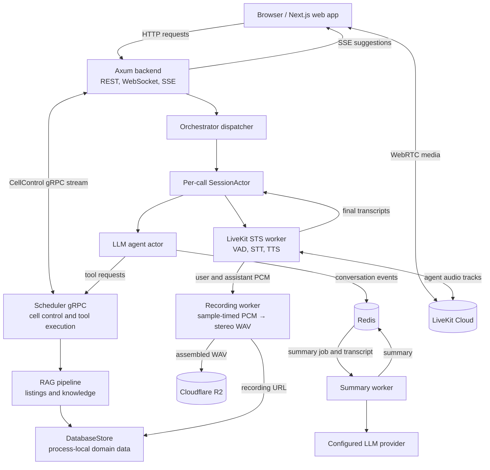

# Real Estate Voice Assistant

A Rust and Next.js application for real-estate voice calls, property and knowledge search, viewing bookings, contract review, and call summaries. The development Compose stack runs the web app, backend API, scheduler, and summary worker. LiveKit, Redis, Cloudflare R2, and the configured LLM provider are external dependencies.

## Architecture



## Call workflow

When a caller starts a session, the backend creates a per-call `SessionActor` and returns the credentials needed to join a LiveKit room. The browser sends and receives audio directly through LiveKit; the backend's STS worker joins the same room to process incoming audio and publish the assistant's voice. VAD detects speech, STT produces a transcript, and the agent uses listing or knowledge context to answer. When a tool is needed, the agent calls the scheduler over gRPC, where the RAG and booking tools run.

User and assistant PCM frames are collected alongside the live call. When the session ends, the recording worker places frames on a sample-based timeline, assembles separate speaker tracks into a stereo 16 kHz WAV, and uploads it to Cloudflare R2. Conversation events and summary jobs use Redis. The worker loads the transcript events for a completed call, asks the configured LLM to summarize them, and saves the summary.

## Services

| Service | Role |
|---|---|
| `web` | Next.js caller and admin interface. |
| `backend` | Axum APIs, LiveKit token issuance, session orchestration, and SSE. |
| `scheduler` | Cell control stream and gRPC tool execution for RAG and bookings. |
| `worker` | Redis summary-job polling, transcript loading, and LLM summaries. |

## Run locally

From this directory:

```bash
docker compose -f docker-compose.dev.yml up --build
```

Set the required service configuration in the relevant `.env` files before starting the stack. Compose starts the four services above; configure LiveKit, Redis, R2, and the LLM provider separately. No PostgreSQL service is included in the current development Compose stack, and each Rust service owns its own `DatabaseStore` process state.

The web app is served on port `3000`, the backend on `4000`, and the scheduler gRPC service on `50051` (metrics on `9090`).

## Repository layout

- `apps/web` — Next.js application
- `crates/services/server` — backend API
- `crates/services/scheduler` — cell control and tool execution service
- `crates/services/worker` — call summary worker
- `crates/libs/orchestrator` — session actors, LiveKit STS, recording assembly, and R2 upload
- `crates/libs/agent` — LLM agent and tool request handling
- `crates/libs/rag` — listing and knowledge retrieval
- `crates/libs/db` — domain store and Redis integration
- `proto` — gRPC protocol definitions
