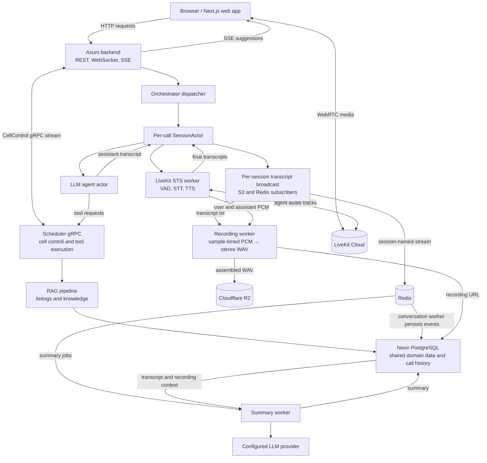

# Real Estate Voice Assistant

A Rust and Next.js application for real-estate voice calls, property and knowledge search, viewing bookings, contract review, and call summaries. The development Compose stack runs the web app, backend API, scheduler, and summary worker. Neon PostgreSQL, LiveKit, Redis, Cloudflare R2, and the configured LLM provider are external dependencies.

## Architecture



## Call workflow

When a caller starts a session, the backend creates a per-call `SessionActor` and returns the credentials needed to join a LiveKit room. The browser sends and receives audio directly through LiveKit; the backend's STS worker joins the same room to process incoming audio and publish the assistant's voice. VAD detects speech, STT produces a transcript, and the agent uses listing or knowledge context to answer. When a tool is needed, the agent calls the scheduler over gRPC, where the RAG and booking tools run.

User and assistant PCM frames are collected alongside the live call. Each call owns a Rust broadcast channel: the S3 subscriber writes `transcript.txt` beside the stereo 16 kHz WAV, while the Redis subscriber writes the same events to a stream named exactly after the session. Redis conversation streams have no TTL. The conversation worker reads the Redis stream, commits events to Neon idempotently, then deletes the Redis stream only after that commit succeeds. S3 is an archive and is never used to update Neon. Each agent actor has its own MPSC Redis-poll worker and delay queue, so it can refresh session context without blocking its command loop.

## Services

| Service | Role |
|---|---|
| `web` | Next.js caller and admin interface. |
| `backend` | Axum APIs, LiveKit token issuance, session orchestration, and SSE. |
| `scheduler` | Cell control stream and gRPC tool execution for RAG and bookings. |
| `worker` | Redis summary-job polling, transcript loading, and LLM summaries. |

## Run locally

From this directory:

```bash
docker compose -f docker-compose.dev.yml up --build
```

Set the required service configuration in the relevant `.env` files before starting the stack. Compose starts the four services above; configure LiveKit, Redis, R2, and the LLM provider separately. Set the same Neon pooled `NEON_POOLER_URL` (a hostname ending in `-pooler`) for all three Rust services, then run the migrations below before starting them. `POSTGRES_DIRECT_URL` is optional and is used only by the migration runner. Services share PostgreSQL data through asynchronous connection pools and fail startup if Neon or the schema is unavailable. Domain records have no in-memory or SQLite fallback. Sled is used only for local orchestration slots, not user records or call history.

## Phone-provider ingress

Select one provider through `TELEPHONY_PROVIDER` in `.env`: `twilio`, `telnyx`, `vonage`, `plivo`, `sip`, or `custom`. The default is `disabled`; callbacks for all other providers are rejected. Copy the relevant settings from [telephony.env.example](telephony.env.example), supply that provider's credentials, set `TELEPHONY_PUBLIC_BASE_URL` to the public HTTPS backend origin, and restart the backend. Existing web and model configuration stays the same.

Configure your provider's phone number/application to send **POST** answer/incoming and status callbacks to `https://your-backend.example.com/api/telephony/{provider}/incoming`. For Vonage, explicitly set the answer method to POST and enable signed webhooks. Telnyx requires a Voice API application and `TELNYX_PUBLIC_KEY`; Vonage requires `VONAGE_SIGNATURE_SECRET` (separate from its API secret). Twilio, Telnyx, Plivo and Vonage callbacks use their native signature verification. `TELEPHONY_WEBHOOK_SECRET` signs short-lived, session-bound media URLs for every provider. Do not log these capability URLs.

Incoming calls create `phone:{provider}:{provider_call_id}` sessions. The provider connects to the returned WebSocket URL, caller audio is transcribed through the existing STT service, and the agent's TTS audio returns only to that provider socket. No LiveKit room/token is created for phone sessions. Each call has a bounded output channel, one media socket, barge-in clearing and shutdown cleanup. Twilio, Telnyx and Plivo use mono 8 kHz μ-law; Vonage uses mono 16 kHz signed little-endian PCM. These follow the provider protocols documented by [Twilio](https://www.twilio.com/docs/voice/twiml/stream), [Telnyx](https://developers.telnyx.com/docs/voice/programmable-voice/media-streaming), [Plivo](https://docs.plivo.com/docs/voice/xml/audio-streaming), and [Vonage](https://developer.vonage.com/en/voice/voice-api/concepts/websockets).

Phone audio, transcripts, tool events, recordings and session details are excluded from the browser event bus and web call/admin responses. Server-side recording and persistence still run. Browser call routes reject phone session IDs, so the web client cannot join, pause or end a phone call.

For `sip` and `custom`, the external gateway must translate its provider protocol into this contract:

- Send a POST JSON callback with `call_id`, optional `from` and `event: "start"`, authenticated using `Authorization: Bearer <TELEPHONY_WEBHOOK_SECRET>` (or `x-telephony-secret`). Send `event: "hangup"` when the call ends.
- Connect to the returned `media_url` within 30 seconds and send `{"event":"start","call_id":"<same call_id>","encoding":"pcm_s16le","sample_rate":16000,"channels":1}`.
- Send and receive mono 16 kHz signed little-endian PCM as binary WebSocket packets. Outbound audio is paced in 20 ms packets. On `{"event":"clear"}`, discard any buffered assistant audio.

`GET /api/telephony/status` reports the selected provider and whether its settings are present, without returning credentials. Real provider credentials, a routed phone number and a public HTTPS/WSS endpoint are required for a live call test; local protocol tests do not make billable calls.

The web app is served on port `3000`, the backend on `4000`, and the scheduler gRPC service on `50051` (metrics on `9090`).

## Repository layout

- `apps/web` — Next.js application
- `crates/services/server` — backend API
- `crates/services/scheduler` — cell control and tool execution service
- `crates/services/worker` — call summary worker
- `crates/libs/orchestrator` — session actors, LiveKit STS, recording assembly, and R2 upload
- `crates/libs/agent` — LLM agent and tool request handling
- `crates/libs/rag` — listing and knowledge retrieval
- `crates/libs/db` — domain store and Redis integration
- `proto` — gRPC protocol definitions

Scheduler admission, discovery, routing boundaries, and rollout requirements are documented in [docs/scheduler-routing.md](docs/scheduler-routing.md).

## PostgreSQL schema migrations

Run `python3 scripts/migrate-db.py` with Python 3 and a PostgreSQL `psql` client installed.
The runner reads `POSTGRES_DIRECT_URL` first, then `NEON_POOLER_URL`, `POSTGRES_URL`, or `DATABASE_URL` from the process environment,
then the backend `.env`, then the root `.env`. It applies SQL files in `migrations/`
in one transaction, records checksums in `public.schema_migrations`, and serializes
concurrent migration runs with an advisory lock. Use `--status` to list public tables.
Do not edit applied migration files; add a new numbered SQL migration instead.

Application reads and writes use these tables directly. Booking, notification outbox,
and booking retry responses commit in one transaction; PostgreSQL also enforces one
confirmed booking per listing/time slot. Audio WAV files remain in R2; their locations,
transcript events, user context, and generated summaries are stored in Neon.

For an installation upgrading from Redis call-history storage, run
`cargo run -p db --example import_legacy_redis` with the service environment loaded.
This imports existing summaries, recording metadata, and stream events without deleting
Redis data or overwriting existing Neon records. Re-running it does not duplicate events.
Export any process-local records from the old running service before replacing it;
process-local data cannot be recovered after that process has exited.

`cargo test -p db --lib -- --ignored` runs the opt-in PostgreSQL persistence test using
the configured service environment. It writes uniquely named fixtures, verifies reads
through new connections and concurrent booking protection, then deletes its fixtures.
The older end-to-end tests require their own seeded test database and external services;
do not point those tests at a production database.
